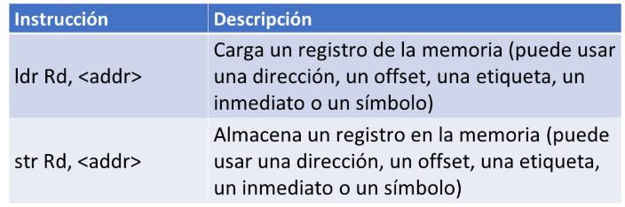
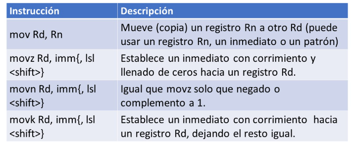
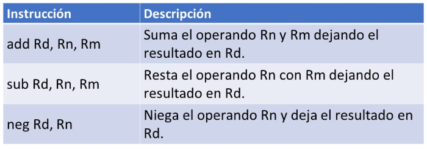
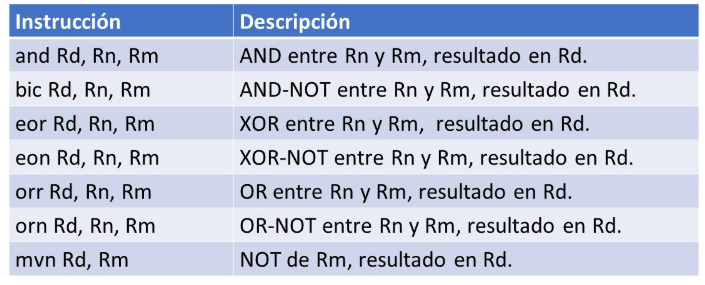
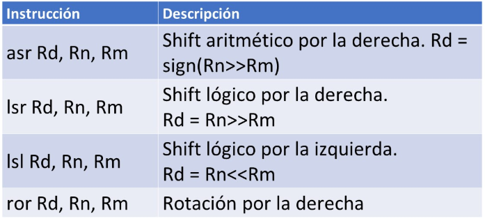
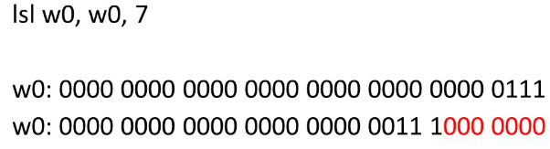
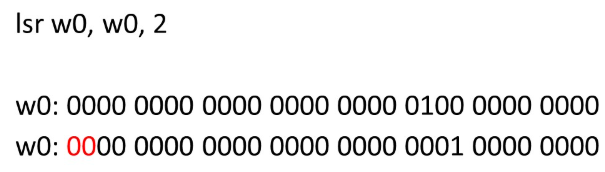
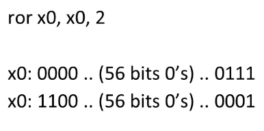
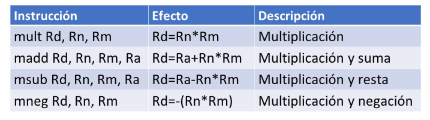
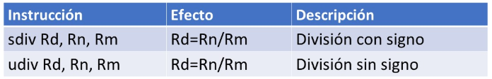

# ARM64 Assembly

## Directivas

### .global o globl
Declaracion de simbolos globales

### .text
Declaracion de codigo en el esegmento text

### .data
Declaracion de datos en el segmento data

### .ascii o .asciz
Declaracion de cadenas

### .section
Declaracion de una seccion especifica

### .equ
Declaracion de constantes simbolicas

### .bss
Declaracion de datos no inicializados

### .space
Declaracion de espacio para almacenar

## Carga y almacenamiento de registro simple

- ldrb: Load Register Byte (sin signo)
→ Carga 1 byte desde memoria y lo guarda en un registro de 32 bits (wX), extendiendo el valor con ceros.

## Operaciones de movimiento de datos

- uxtb: valor de retorno extendido

## Instrucciones aritmeticas

- Si se le agrega "c" se le puede procesar un registro mas siendo el carry ya sea de manera positiva o negativa

### Instrucciones con set flah

Las dos operaciones atimeticas basicas se le puede agregar la letra s a la intruccion y con esto activan el uso de las banderas NZCV  cuando occura una accion

- adds, subs

### Instrucciones logicas

- Las dos operaciones logicas AND y BIC se les puede agregar la letra s a la instruccion y con esto activan el uso de las banderas NZCV cuando ocurra una accion: ands, bics

### Instrucciones de corrimiento

#### Shif logico por la izquierda

#### Shif logico por la derecha

#### Rotacion por la derecha

#### Rotacion aritmetico por la derecha

### Instrucciones de multiplicacion con overflow de 32 a 32 y 64 a 64 bits

### Instrucciones de division entera
